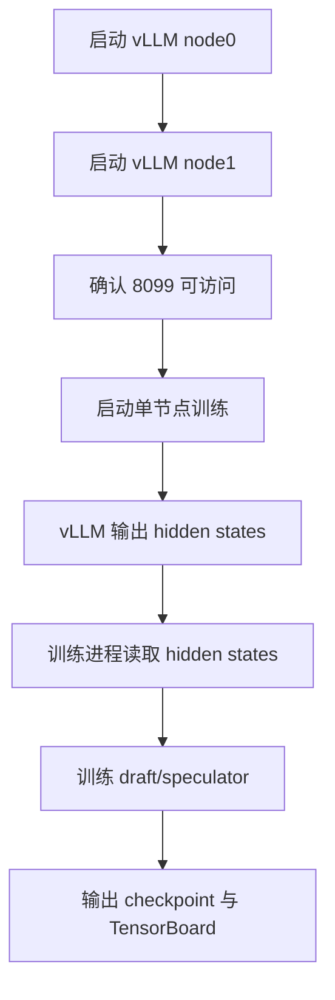

# GLM-5.2 / DSpark 训练指南


1. **推理侧（vLLM）**
   - 生成目标模型的 hidden states
   - 通过 `8099` 端口对外提供推理接口

2. **训练侧**
   - 启动 1 个训练节点
   - 使用 `torchrun` 拉起 16 个 NPU 进程
   - 通过 vLLM 提供的接口读取 hidden states，并训练 draft/speculator 模型

---

## 1. 拓扑结构

### 训练节点
- 节点 IP：xxxxx
- 进程数：`16`
- Master：
  - `MASTER_ADDR=xxxxx`
  - `MASTER_PORT=29101`

### 推理节点
共 2 个 vLLM 实例：

训练脚本连接的是 node0 的推理接口：

```text
http://xxxxx:8099/v1
```

---

## 2. 需要用哪些脚本？

以下脚本全部位于 `speculators` 代码仓根目录。

| 脚本 | 作用 |
|---|---|
| `serve_dp2_node0.sh` | 启动 vLLM node0 |
| `serve_dp2_node1~3.sh` | 启动 vLLM node1~3 |
| `train-glm52-1node.sh` | 启动这次单节点训练 |
| `hs_connectors/src/hs_connectors/transfer.py` | 核心 hidden states 传输与删除逻辑 |

你不需要记住任何绝对路径。
只要先进入 `speculators` 代码仓根目录，再依次执行脚本名即可。

---

## 3. 训练前准备

启动前请确认：

1. 代码仓可访问。
2. 模型和数据集已就绪。
3. NPU / vLLM 环境可用。
4. 三个节点之间网络连通。
5. 端口 `8099`、`29101` 未被占用。
6. 默认通信网卡是 `eth0`。

---

## 4. 推理脚本 node0：``

### 4.1 完整脚本内容
### 注意--served-model-name 要与训练侧 --verifier-name-or-path 一致

```bash
#!/bin/bash
source /usr/local/Ascend/ascend-toolkit/set_env.sh
set -euo pipefail

LOG_DIR="xxxxxx"
mkdir -p "$LOG_DIR"
TS=$(date +%Y%m%d_%H%M%S)
LOG="$LOG_DIR/serve_dp4_node0_16npu_${TS}.log"
exec > "$LOG" 2>&1


nic_name="eth0"
local_ip="xxxxx"
node0_ip="xxxxxx"

export HCCL_OP_EXPANSION_MODE="AIV"
export HCCL_IF_IP=$local_ip
export GLOO_SOCKET_IFNAME=$nic_name
export TP_SOCKET_IFNAME=$nic_name
export HCCL_SOCKET_IFNAME=$nic_name
export OMP_PROC_BIND=false
export OMP_NUM_THREADS=1
export HCCL_BUFFSIZE=600
export HCCL_IF_BASE_PORT=60000
export HCCL_CONNECT_TIMEOUT=3600
export PYTORCH_NPU_ALLOC_CONF=expandable_segments:True
export VLLM_ASCEND_BALANCE_SCHEDULING=0

python scripts/launch_vllm.py \
    xxxxxx \
    --target-layer-ids 2 22 38 58 74 \
    --hidden-states-path ./hidden_states \
    -- --served-model-name 'xxxxx' \ 
    --host 0.0.0.0 \
    --port 8099 \
    --tensor-parallel-size 16 \
    --data-parallel-size 4 \
    --data-parallel-size-local 1 \
    --data-parallel-start-rank 0 \
    --data-parallel-address $node0_ip \
    --data-parallel-rpc-port 12346 \
    --enable-expert-parallel \
    --seed 1024 \
    --max-num-seqs 128 \
    --max-model-len 8199 \
    --trust-remote-code \
    --gpu-memory-utilization 0.86 \
    --max-num-batched-tokens 16384 \
    --hf-overrides '{"use_index_cache": true}' \
    --enforce-eager
```

### 4.2 关键参数说明

| 参数 | 值 | 说明 |
|---|---:|---|
| `local_ip` | `10.30.14.37` | node0 本机 IP |
| `data-parallel-start-rank` | `0` | node0 在 DP 组中的编号 |
| `tensor-parallel-size` | `16` | 单节点 16 NPU 全部参与张量并行 |
| `data-parallel-size` | `2` | 两个推理实例组成 DP=2 |
| `data-parallel-size-local` | `1` | 每个节点本地只有 1 个 DP 实例 |
| `data-parallel-address` | `10.30.14.37` | DP 组地址指向 node0 |
| `data-parallel-rpc-port` | `12345` | DP 组内部 RPC 端口 |
| `max-model-len` | `8199` | 单条序列最大长度 |
| `max-num-batched-tokens` | `16384` | 单批最大 token 数 |
| `gpu-memory-utilization` | `0.80` | 显存占用比例 |
| `enforce-eager` | `true` | 关闭 CUDA Graph，降低启动复杂度 |
| `hf-overrides` | `{"use_index_cache": true}` | 开启 index cache |
| `target-layer-ids` | `2 22 38 58 74` | 目标层编号，必须与训练侧一致 |

### 4.3 环境变量含义

```bash
HCCL_OP_EXPANSION_MODE="AIV"
GLOO_SOCKET_IFNAME="eth0"
TP_SOCKET_IFNAME="eth0"
HCCL_SOCKET_IFNAME="eth0"
OMP_PROC_BIND=false
OMP_NUM_THREADS=1
HCCL_BUFFSIZE=600
HCCL_CONNECT_TIMEOUT=3600
PYTORCH_NPU_ALLOC_CONF=expandable_segments:True
VLLM_ASCEND_BALANCE_SCHEDULING=0
```

要点：
- `HCCL_IF_IP` 是本机 IP。
- 三个 `SOCKET_IFNAME` 都固定为 `eth0`。
- `PYTORCH_NPU_ALLOC_CONF` 用来稳定 NPU 显存布局。
- `VLLM_ASCEND_BALANCE_SCHEDULING=0` 关闭动态平衡调度差异。

---

## 5. 推理脚本 node1：`serve_dp2_node1.sh`

### 5.1 完整脚本内容

```bash
#!/bin/bash
source /usr/local/Ascend/ascend-toolkit/set_env.sh
set -euo pipefail

LOG_DIR="xxxxxx"
mkdir -p "$LOG_DIR"
TS=$(date +%Y%m%d_%H%M%S)
LOG="$LOG_DIR/serve_dp2_node1_16npu_${TS}.log"
exec > "$LOG" 2>&1

nic_name="eth0"
local_ip="10.30.14.247"
node0_ip="10.30.14.37"

export HCCL_OP_EXPANSION_MODE="AIV"
export HCCL_IF_IP=$local_ip
export GLOO_SOCKET_IFNAME=$nic_name
export TP_SOCKET_IFNAME=$nic_name
export HCCL_SOCKET_IFNAME=$nic_name
export OMP_PROC_BIND=false
export OMP_NUM_THREADS=1
export HCCL_BUFFSIZE=600
export HCCL_CONNECT_TIMEOUT=3600
export PYTORCH_NPU_ALLOC_CONF=expandable_segments:True
export VLLM_ASCEND_BALANCE_SCHEDULING=0

python scripts/launch_vllm.py \
    /a3_inference/itask/workdir/wjf02357757/GLM-5.2-w4a8-moe \
    --target-layer-ids 2 22 38 58 74 \
    --hidden-states-path /a3_inference/itask/workdir/wjf02357757/spec_code/hidden_states \
    -- --served-model-name '/a3_inference/itask/workdir/wjf02357757/GLM-5.2' \
    --host 0.0.0.0 \
    --port 8099 \
    --tensor-parallel-size 16 \
    --data-parallel-size 2 \
    --data-parallel-size-local 1 \
    --data-parallel-start-rank 1 \
    --data-parallel-address $node0_ip \
    --data-parallel-rpc-port 12345 \
    --enable-expert-parallel \
    --seed 1024 \
    --max-num-seqs 128 \
    --max-model-len 8199 \
    --trust-remote-code \
    --gpu-memory-utilization 0.80 \
    --max-num-batched-tokens 16384 \
    --hf-overrides '{"use_index_cache": true}' \
    --enforce-eager
```

### 5.2 和 node0 的唯一区别

```bash
# node0
local_ip="xxxx"
--data-parallel-start-rank 0

# node1
local_ip="xxxx"
--data-parallel-start-rank 1
```

其余配置完全一致。

---

## 6. 推理侧的通用注意事项

1. 两个推理节点要同时启动后，`8099` 才真正可用。
2. `target-layer-ids` 必须和训练脚本一致，否则训练会读不到指定层。
3. `hidden-states-path` 是 vLLM 输出 hidden states 的位置。
4. `data-parallel-address` 必须指向 node0。
5. `gpu-memory-utilization` 不建议随意调大，容易引起显存溢出。
6. 若训练与推理共用 node0 端口，务必保证训练节点的 `vllm-endpoint` 指向正确。

---

## 7. 训练脚本：`train-glm52-1node.sh`

### 7.1 完整脚本内容

```bash
#!/bin/bash
# Single-node GLM-5.2 dspark training via torchrun (16 NPUs).
# Usage: bash train-glm52-1node.sh
set -euo pipefail
cd /a3_inference/itask/workdir/wjf02357757/spec_code/speculators
export PYTHONPATH="/a3_inference/itask/workdir/wjf02357757/spec_code/speculators/hs_connectors/src:/a3_inference/itask/workdir/wjf02357757/spec_code/speculators/src:/usr/local/Ascend/cann-9.2.0/python/site-packages:/usr/local/Ascend/cann-9.2.0/opp/built-in/op_impl/ai_core/tbe:/usr/local/lib/python3.11/site-packages:/usr/local/lib64/python3.11/site-packages:/usr/local/Ascend/ascend-toolkit/latest/python/site-packages:/usr/local/Ascend/ascend-toolkit/latest/opp/built-in/op_impl/ai_core/tbe:"

MASTER_ADDR="10.30.14.114"
MASTER_PORT="29101"
NNODES=1
NPROC_PER_NODE=16
NODE_RANK=0
LOCAL_IP="10.30.14.114"
NIC_NAME="eth0"

export HCCL_OP_EXPANSION_MODE="AIV"
export OMP_PROC_BIND=false
export OMP_NUM_THREADS=1
export HCCL_BUFFSIZE=600
export HCCL_CONNECT_TIMEOUT=3600
export PYTORCH_NPU_ALLOC_CONF=expandable_segments:True
export VLLM_ASCEND_BALANCE_SCHEDULING=0
export HCCL_EVENT_TIMEOUT=3600

export HCCL_IF_IP="${LOCAL_IP}"
export GLOO_SOCKET_IFNAME="${NIC_NAME}"
export TP_SOCKET_IFNAME="${NIC_NAME}"
export HCCL_SOCKET_IFNAME="${NIC_NAME}"

echo "[$(date '+%F %T')] starting single-node train: local_ip=${LOCAL_IP} master=${MASTER_ADDR}:${MASTER_PORT} nproc=${NPROC_PER_NODE}"

torchrun --standalone --nproc-per-node 16 \
  -m speculators.train \
  --verifier-name-or-path xxxxxx \
  --speculator-type dspark \
  --num-layers 5 \
  --block-size 8 \
  --data-path /a3_inference/itask/workdir/wjf02357757/spec_code/glm52-dataset \
  --vllm-endpoint http://xxxxxx:8099/v1 \
  --save-path /a3_inference/itask/workdir/wjf02357757/spec_code/outputs-glm-1120 \
  --epochs 3 \
  --lr 0.00006 \
  --scheduler-type cosine \
  --scheduler-warmup-ratio 0.02 \
  --total-seq-len 4096 \
  --draft-arch glm5 \
  --draft-hidden-act silu \
  --target-layer-ids 2 22 38 58 74 \
  --max-anchors 800 \
  --markov-rank 256 \
  --enable-confidence-head \
  --confidence-head-with-markov \
  --loss-fn '{"ce": 0.1, "tv": 0.9}' \
  --confidence-head-alpha 1 \
  --checkpoint-freq 0.1 \
  --on-missing generate \
  --on-generate delete \
  --seed 42 \
  --log-freq 10 \
  --num-workers 12 \
  --request-timeout 3600 \
  --max-retries 8 \
  --trust-remote-code \
  --hidden-states-path xxxxxx \
  --attn-implementation sdpa \
  --fsdp-shard \
  --dflash-decay-gamma 16 \
  --train-data-ratio 0.99 \
  --noise-std 0.01 \
  --full-attention-indices 0 1 2 3 4 \
  --logger tensorboard
```

### 7.2 训练拓扑参数

| 参数 | 值 | 说明 |
|---|---:|---|
| `MASTER_ADDR` | `10.30.14.114` | 主节点 IP |
| `MASTER_PORT` | `29101` | torchrun 通信端口 |
| `NNODES` | `1` | 单节点训练 |
| `NPROC_PER_NODE` | `16` | 每节点 16 个 NPU |
| `NODE_RANK` | `0` | 单节点编号 |
| `LOCAL_IP` | `10.30.14.114` | 训练节点本机 IP |
| `NIC_NAME` | `eth0` | 网卡名 |

### 7.3 模型与数据路径

```bash
--verifier-name-or-path /a3_inference/itask/workdir/wjf02357757/GLM-5.2-w4a8-moe
--data-path /a3_inference/itask/workdir/wjf02357757/spec_code/glm52-dataset
--vllm-endpoint http://10.30.14.37:8099/v1
--hidden-states-path /a3_inference/itask/workdir/wjf02357757/spec_code/hidden_states
```

含义：
- `verifier-name-or-path`：目标验证模型
- `data-path`：训练数据
- `vllm-endpoint`：vLLM 推理接口
- `hidden-states-path`：vLLM 输出给训练侧的 hidden states

---

## 8. 训练核心超参

### 8.1 模型结构

| 参数 | 值 | 说明 |
|---|---:|---|
| `speculator-type` | `dspark` | 使用 DSpark 训练方案 |
| `num-layers` | `5` | draft/speculator 层数 |
| `block-size` | `8` | 每块序列长度 |
| `target-layer-ids` | `2 22 38 58 74` | 从目标模型中取哪些层 |
| `full-attention-indices` | `0 1 2 3 4` | 0~4 层使用 full attention |
| `attn-implementation` | `sdpa` | draft 侧注意力实现 |
| `draft-arch` | `glm5` | draft 模型结构 |
| `draft-hidden-act` | `silu` | 激活函数 |

### 8.2 学习率与调度

| 参数 | 值 | 说明 |
|---|---:|---|
| `lr` | `0.00006` | 学习率 |
| `scheduler-type` | `cosine` | 余弦衰减 |
| `scheduler-warmup-ratio` | `0.02` | 前 2% 步 warmup |
| `epochs` | `3` | 总训练轮数 |

### 8.3 序列与 anchor

| 参数 | 值 | 说明 |
|---|---:|---|
| `total-seq-len` | `4096` | 单条训练样本序列长度 |
| `max-anchors` | `800` | 每条序列最大 anchor 数 |
| `markov-rank` | `256` | Markov 状态维度 |
| `block-size` | `8` | 每块长度 |
| `train-data-ratio` | `0.99` | 训练数据占比 |
| `noise-std` | `0.01` | 输入扰动强度 |

### 8.4 损失与置信头

| 参数 | 值 | 说明 |
|---|---:|---|
| `loss-fn` | `{"ce": 0.3, "tv": 0.7}` | CE 和 TV 混合损失 |
| `confidence-head-alpha` | `1` | 置信头权重 |
| `confidence-head-with-markov` | `true` | 置信头和 Markov 状态联合 |
| `enable-confidence-head` | `true` | 开启置信头 |
| `dflash-decay-gamma` | `16` | DFlash 衰减系数 |

### 8.5 稳定性与日志

| 参数 | 值 | 说明 |
|---|---:|---|
| `request-timeout` | `3600` | vLLM 请求超时 |
| `max-retries` | `8` | 请求最大重试次数 |
| `checkpoint-freq` | `0.1` | 每 10% 保存一次 checkpoint |
| `log-freq` | `10` | 每 10 个 step 记录一次日志 |
| `num-workers` | `12` | DataLoader 进程数 |
| `on-missing` | `generate` | hidden states 缺失时重新生成 |
| `on-generate` | `delete` | 生成后删除临时文件 |

---

## 9. 训练启动顺序

### 第 1 步：进入代码仓根目录

```bash
# 在 node0、node1、训练节点上都要先进入 speculators 代码仓根目录
```

### 第 2 步：启动 node0 推理

```bash
bash serve_dp2_node0.sh
```

### 第 3 步：启动 node1~3 推理

```bash
bash serve_dp2_node1~3.sh
```

### 第 4 步：确认 8099 端口可用

```bash
nc -vz xxxxx 8099
```

或访问：

```bash
curl http://xxxxxx:8099/v1/models
```

如果你看到模型列表，说明推理侧已就绪。

### 第 5 步：启动训练

```bash
bash train-glm52-1node.sh
```

---

## 10. 训练流程示意图



---

## 11. 训练过程中重点监控指标

### 11.1 收敛指标

- `train/loss`
- `train/accept_rate`
- `train/accept_len`
- `train/full_acc`
- `train/ce_loss`
- `train/tv_loss`

### 11.2 性能指标

- `profile/fetch_ms`
- `profile/fwd_ms`
- `profile/bwd_ms`
- `profile/opt_ms`
- `profile/step_ms`
- `profile/tokens_per_s`

### 11.3 判断是否正常

1. `loss` 应平稳下降。
2. `accept_rate` 应逐步上升后趋稳。
3. `accept_len` 应逐步接近目标值，常见目标是 `5`。
4. `step_ms` 不应剧烈抖动。
5. 如果 `fetch_ms` 很高，优先排查数据加载与 hidden states 读取。

---

## 12. 核心代码修改：`hs_connectors/src/hs_connectors/transfer.py`

### 12.1 为什么要改？
本次训练依赖共享文件系统来传递 hidden states。  
共享文件系统可能出现：
- 锁已经释放
- 但目标 safetensors 文件还没同步可见

原逻辑会误判为“文件不存在”，导致训练失败。  
因此改成了 **轮询等待 60 秒**。

### 12.2 改动 diff

```diff
-    if file_path.exists():
-        return load_file(file_path)
-
-    return None
+    # Shared filesystems can briefly expose a released lock before the new
+    # safetensors file becomes visible to another pod. Poll instead of treating
+    # that transient window as a permanent miss.
+    deadline = time.monotonic() + 60.0
+    while True:
+        if file_path.exists():
+            return load_file(file_path)
+        if time.monotonic() >= deadline:
+            return None
+        time.sleep(0.1)
```

另一个修改：

```diff
-    Path(handle).unlink()
+    Path(handle).unlink(missing_ok=True)
```

### 12.3 作用
1. 改文件存在性判断：从“立即失败”改为“最多等待 60 秒”。
2. 删除文件时：文件不存在也不再抛异常。

---

## 13. 常见问题与排查

### 1. vLLM 启动失败
可能原因：
- 网卡名不是 `eth0`
- 端口 `8099` 被占用
- `data-parallel-size` 和实际节点数不匹配
- `gpu-memory-utilization` 设置过高

处理方式：
- 到 `serve_dp2_node*.sh` 中确认 `nic_name` 和端口。
- 先只启动 node0，看是否单节点可用，再启动 node1。
- 必要时把 `gpu-memory-utilization` 降到 `0.75`。

### 3. 训练提示 hidden states 读取异常
可能原因：
- vLLM 尚未写完 hidden states
- 共享文件系统存在可见性延迟
- 文件被其他进程抢先删除

处理方式：
- 等待一段时间，训练有内置轮询和重试。
- 确认推理脚本的 `hidden-states-path` 与训练侧一致。
- 如果仍然不稳，可以把 `request-timeout` 或 `max-retries` 适当加大。

### 4. OOM / 显存不足
处理方式：
- 降低 `gpu-memory-utilization`
- 减小 `max-num-seqs`
- 减小 `max-num-batched-tokens`
- 训练侧可用更小的 batch 策略或梯度检查点

### 5. 有 OOM 但两个节点都有空 NPU
优先检查：
- 是否 `DP=2` 已正确生效
- `data-parallel-start-rank` 是否分别是 `0` / `1`
- `data-parallel-address` 是否正确指向 node0

---

## 14. 训炼结束后你会得到什么？

1. 一个训练完成的 draft/speculator checkpoint
2. TensorBoard 日志
3. 训练指标曲线
4. 可用于后续推理加速评估的模型

如果你之后要做评估，优先看：
- **accept_len**：越高越好
- **accept_rate**：越高越好
- **end-to-end latency**：是否下降
- **throughput**：是否提升

---

## 15. 关键注意事项

1. 先启动推理，再启动训练。
2. `eth0` 和 `HCCL_IF_IP` 必须正确。
3. vLLM 的 `target-layer-ids` 必须与训练侧一致。
4. NPU 数量不匹配时，不要随意修改 `tensor-parallel-size`。
5. 如果不确定训练是否读完 hidden states，先检查 `accept_rate` / `profile/fetch_ms`。
6. `vllm-endpoint` 必须指向 node0。
7. 训练脚本中的 `hidden-states-path` 必须和推理脚本保持一致。
