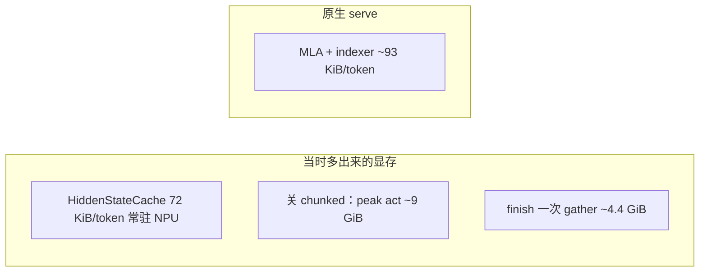
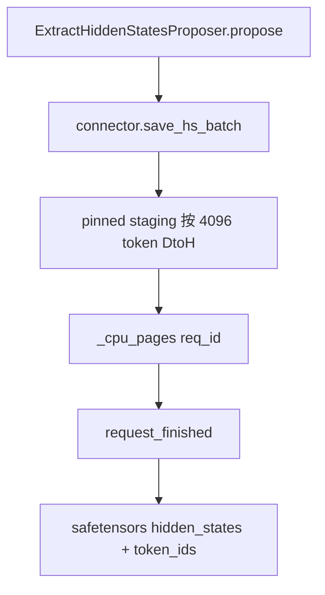

# launch_vllm 长序列显存优化：把 Hidden State 移出 NPU KV

本文记录 `launch_vllm` 在 64k/128k 上相对原生 `vllm serve` 更吃显存的根因、不减层不降精度的解法、代码落地，以及 GLM-5.2 / Kimi-K3 的实测。只影响 `extract_hidden_states` 抽取链路；普通推理和其他投机方法不走这些分支。

环境：Ascend 910A3，16 卡 TP，`gpu-memory-utilization 0.90`（基线对照里 launch_vllm 曾用 0.80），vLLM 0.26.1 + vllm-ascend。模型默认 GLM-5.2-w4a8-moe（hidden=6144，抽 6 层）。

---

## 1. 根因

`launch_vllm` 为在线/离线 Eagle 训练注入 `method=extract_hidden_states`，把若干层 aux hidden 写进独立的 `HiddenStateCacheSpec`，再在 `request_finished` 里 gather 成 safetensors。原生 `vllm serve` 不做这件事。

早期对照（chunked prefill 关闭、util 0.80）把账算清：

| | 每 token KV | 64k 一条占比 | 单引擎 64k 上限 |
|---|---|---|---|
| 原生 MLA + indexer | **~93 KiB**（测到 94 KB 量级） | — | **4.49x**（294,144 tokens） |
| launch_vllm（HS 在 NPU） | **~165 KiB** | ~47% | 理论上限约 **2** 条 |

多出来的约 60–72 KiB 正好是 HiddenStateCache：

```text
# 计划里按 5 层估：5 × 6144 × bf16 = 60 KiB/token
# 实际默认 include-last-layer，6 层：
6 × hidden_size 6144 × 2 B = 72 KiB/token
```

`ExtractHiddenStatesModel` 把「层数」当成 `num_heads`、把 `hidden_size` 当成 `head_size`，不 reshape 就 scatter 进 hybrid BlockPool。这组 cache：

- 不量化、不 TP 切分（每卡 allreduce 后已是完整 6144）
- 和 MLA/indexer **叠加**进同一套 `num_blocks`
- 全序列常驻，直到请求结束才写出

因此单机 TP16、无 DP 时，4 条 unique 64k 会打进同一引擎，KV 必然打满。原生 serve 不做 HS 抽取，并发上限会永远更高；优化目标是量化「固有成本 vs 可避免成本」，并在**不减层、不降 bf16** 的前提下把可避免成本拿掉。

当时还有两笔**可避免**的显存，和 HS 常驻不是同一件事：

1. **`launch_vllm.py` 曾无条件 `--no-enable-chunked-prefill`**  
   `max_num_batched_tokens` 被抬到 `max_model_len`，64k 峰值激活约 **9.0 GiB**（原生 chunked 约 **0.18 GiB**），proposer buffer 再占数 GiB。
2. **结束时一次 gather 整段 64k HS**  
   约 4.4 GiB NPU + 4.4 GiB pin memory；多请求同时 finish 会叠加，C2 即可把 EngineCore 打挂。

`--max-num-seqs 4` 只是调度准入，改不了每 token 单价，不能当显存方案。



---

## 2. 分步收敛

按侵入性从低到高。前两步消掉激活和 gather 尖峰，**KV 单价仍是 165 KiB**；真正把 64k 容量拉回接近原生的是第三步。

| 阶段 | 做了什么 | 64k KV | peak act | 并发表现 |
|---|---|---|---|---|
| 基线 | chunked 关，util 0.80，HS 在 NPU | 66,560 / **1.02x** | 9.0 GiB | HTTP 可串行跑完；KV 连 2 条 64k 都装不下 |
| P0 | 打开 chunked，`--max-num-batched-tokens 8192`，util 0.90 | 158,032 / **2.41x** | **1.13 GiB** | C1 成功；C2 在 finish gather 时 EngineDead |
| P1 | connector 分块 gather + `num_writer_threads=2` | 仍 2.41x | 1.13 GiB | unique C1/C2/C4/C8 HTTP 成功，引擎存活 |
| **P2（本方案）** | **HS 不再进 NPU BlockPool，只在 TP0 CPU 分页** | **280,420 / 4.28x** | 1.13 GiB | 与原生 4.49x 同档；C1–C8 全成功 |

P0/P1 之后固有上限仍是 ~2.41 条 64k。要在不减层、不降精度时再往上，只能把 72 KiB/token **搬出 NPU hybrid KV**。

---

## 3. 方案：NPU 上取消 HiddenStateCacheSpec，TP0 CPU 按 token 分页

约束：**6 层、bf16 不变**；MLA/indexer 仍在 NPU；尽量保住 prefix cache / 抢占 / chunked prefill 拼条语义。

不采用的路：

- 减层、fp8/int8 HS
- 把 6144 做 TP-shard 再 allgather（finish 时每卡再出 4.4 GiB，和当初 gather 尖峰同类）
- 把 MLA KV 搬到 CPU
- 用 `max-num-seqs` 假装治好 OOM

推荐形态：

```text
target aux HS
  → 每步 chunk DtoH（仅 TP0）
  → CPU paged HS（按 req_id、逻辑 token 下标）
  → request_finished：CPU concat + save_file
```

相对「算完就落盘」：CPU 页表能在 prefix 命中时留下旧行，chunked prefill / decode 按 `num_computed_tokens` 追加，abort 丢页即可。相对「继续放 NPU KV」：NPU 每 token 回到 MLA+indexer，finish 不再从 NPU gather 整段序列。

预期：NPU KV 回到 ~93 KiB/token，64k 从 2.41x 回到 ~4.4x；TP0 按原生容量大约 `294k × 72 KiB ≈ 21 GiB` CPU HS；非 0 卡不存。

开关：`kv_connector_extra_config.hs_store_device=cpu`（`launch_vllm.py` 默认）。`npu` 时整条短路，可再叠加 `scripts/patch_hs_chunked_gather.py`。

---

## 4. 代码实现

不 fork vLLM。可重入 patch 打进 site-packages，marker 为 `HS_CPU_PAGES`。

### 4.1 本仓库

| 文件 | 作用 |
|---|---|
| [`scripts/patch_hs_cpu_pages.py`](../../scripts/patch_hs_cpu_pages.py) | 改 4 个上游文件（见下） |
| [`scripts/launch_vllm.py`](../../scripts/launch_vllm.py) | 不再强制 `--no-enable-chunked-prefill`；extra 默认 `hs_store_device=cpu`、`hs_gather_chunk_tokens=4096`、`num_writer_threads=2`、`kv_buffer_size=64MiB` |
| [`docs/cli/launch_vllm.md`](../cli/launch_vllm.md) | 说明 HS 不占 NPU KV |

新容器每台 serve 节点：

```bash
python scripts/patch_hs_cpu_pages.py
```

Kimi-K3 w4a8 另需 `scripts/patch_kimi_mm_rot_proj.py`（`mm_projector.rot_proj`），与显存方案无关。

### 4.2 site-packages 四处改动

**`vllm_ascend/worker/model_runner_v1.py`**  
收集 `kv_cache_spec` 时，`CacheOnlyAttentionLayer` 在 `hs_store_device=cpu` 下 `continue`，**不注册 `HiddenStateCacheSpec`**。这是 72 KiB/token 进 hybrid pool 的入口。

**`vllm/model_executor/models/extract_hidden_states.py`**  
`CacheOnlyAttentionLayer.forward`：本层 `kv_cache.numel()==0` 则跳过 `unified_kv_cache_update` / `dummy_attention`。

**`vllm/v1/spec_decode/extract_hidden_states.py`**（proposer）

- `validate_same_kv_cache_group`：HS 层不在任何 NPU group 时，复用 group 0 的 `common_attn_metadata`。
- `propose`：stack 完本 step HS 后调用 connector `save_hs_batch`，然后 return，不再写 NPU cache-only 层。

**`vllm/distributed/kv_transfer/kv_connector/v1/example_hidden_states_connector.py`**

- 仅 TP0 维护 `_cpu_pages[req_id]`；`register_kv_caches` 不再绑定 NPU HS tensor。
- `save_hs_batch`：本 step `[tokens, layers, hidden]` 按 4096 token DtoH 到 pinned staging，再按 `query_start_loc` / `num_computed_tokens` 写入 CPU page。chunked prefill 能接上；prefix 命中的前缀行保留。
- `_submit_async_write`：结束时 `page[:num_tokens]` → safetensors，**不再 `extract_from_kv_cache`**。
- `request_finished`：abort 丢页；CPU 模式立刻归还 MLA block（block 里本来没有 HS）。



这些类和 connector 只在 `extract_hidden_states` + `ExampleHiddenStatesConnector` 下出现。普通 `vllm serve`、Eagle/MTP/ngram 不进上述分支。

---

## 5. 实测验证

压测均为 unique-prefix prompt、`max_tokens=1`，避免 decode 拉长 KV。`--max-num-batched-tokens 8192` 让单副本超长 prefill 在**计算上**基本串行；下表「x」是 **KV 能同时驻留几条满上下文**，不是同一时刻有几条在算。

### 5.1 GLM-5.2 单机 TP16，64k

`max-model-len=65538`，抽层 `[2, 22, 38, 58, 74, 78]`。

| | KV tokens | 64k 并发 | peak act | dump |
|---|---|---|---|---|
| 基线 launch_vllm（chunked 关） | 66,560 | 1.02x | 9.0 GiB | — |
| P0/P1（HS 仍在 NPU） | 158,032 | 2.41x | 1.13 GiB | — |
| **HS → TP0 CPU** | **280,420** | **4.28x** | 1.13 GiB | `(63979, 6, 6144)` bf16，~4.39 GiB |
| 原生 `vllm serve` | 294,144 | **4.49x** | 0.18 GiB | 无 HS |

unique C1/C2/C4/C8 全部 HTTP 200，引擎存活。`4 × 65538 = 262k < 280k`，第 5 条要 328k，装不下 → **满 64k 驻留上限 = 4**。相对原生约 95%；剩下约 5% 是抽 HS 的峰值激活（1.13 vs 0.18 GiB），不够再塞第 5 条，也不是 HS 还躺在 NPU 上。

### 5.2 GLM-5.2 四机 DP4 × TP16 × EP，128k

`max-model-len=131072`，`max-num-seqs=4`，util 0.90。每副本 KV **460,800 tokens / 3.52x**（DP2 为 460,928）。

| 全局并发 | 每副本 | 结果 | wall |
|---|---|---|---|
| C1 | 1 | 1/1 | 55s |
| C4 | 1 | 4/4 | 71s |
| C8 | 2 | 8/8 | 126s |
| C12 | 3 | 12/12 | 188s |
| C16 | 4 | 16/16 | 250s |

C16 能过，是因为 8192 chunk 把同副本的 128k 排成约 65s 一波，KV **并没有**同时站住 4 条满 128k。`3 × 131072 = 393k < 460k`，第 4 条要 524k → **满 128k 驻留上限 = 每副本 3、全局 12**。与原生同一档；要到每副本 4 条满 128k，KV 至少再涨约 14%。

### 5.3 Kimi-K3 四机 DP4 × TP16 × EP64，128k

权重 w4a8 ~1.4 TiB，必须 EP 切到 64 卡。抽层 `[2, 46, 90, 93]`，hidden=7168 → HS 约 `4 × 7168 × 2 ≈ 56 KiB/token`（已在 CPU）。每副本 KV **365,209 tokens / 2.79x**（权重吃掉大量 HBM，所以低于 GLM 的 3.52x）。

| 并发 | 结果 | 说明 |
|---|---|---|
| C1 | 1/1，27.6s，prompt 126092 | dump `(126092, 4, 7168)` |
| C2 | 2/2，34.7s | 两副本同时 prefill 稳定 |
| C3 / C4 | EngineDead ~324s | 64 卡 expert `ALLTOALLV` `EI0002`，不是 KV |

KV 理论上每副本 2 条满 128k、全局 8；**同时 prefill 的稳定上限是 2**，瓶颈在 EP all2all，不是 HS。

---

## 6. 结论

1. 64k 上 launch_vllm 比原生贵，主因曾是三笔：关 chunked 的 ~9 GiB 激活、finish 整段 gather、以及 **72 KiB/token 的 NPU HiddenStateCache**。前两笔是可避免成本，P0/P1 已去掉。
2. 不减层、不降精度时，第三笔只能搬家：HS 退出 NPU BlockPool，TP0 逐步 DtoH 到 CPU page。GLM 64k KV 从 **2.41x → 4.28x**（原生 4.49x）；128k 四机满长度驻留 **12**，与原生一档。
3. `--max-num-seqs` / 再拧 chunk 大小都不是把单价打下来的那一刀。再涨满 128k 驻留只能加 DP、缩短真实序列、或动 MLA KV。
4. 补丁只作用于 hidden-state 抽取；`hs_store_device=npu` 可回退。
